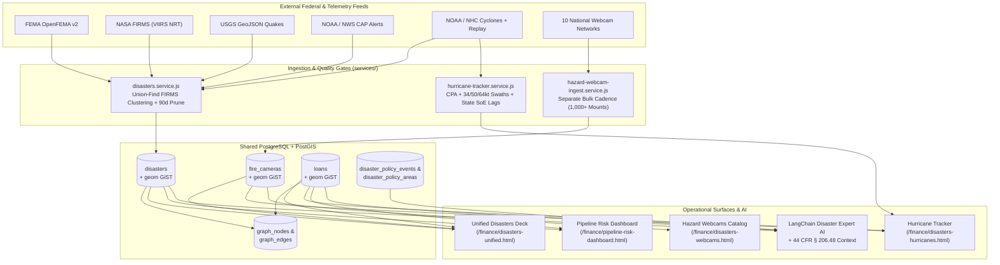

# Unified Disasters & Mortgage Pipeline Hazard Intelligence

**White Paper & Executive / Board Briefing**  
**Organization:** DevConnect Labs  
**Primary Surfaces:** `/finance/disasters-unified.html`, `/finance/disasters-hurricanes.html`, `/finance/disasters-webcams.html`, `/finance/pipeline-risk-dashboard.html`, `/disaster-impact-graph.html`  

---

## Part I — Executive & Board Briefing

### 1. Executive Thesis

When wildfires, hurricanes, floods, or earthquakes strike, mortgage lenders face an immediate operational blind spot: **federal hazard telemetry is scattered across five different agencies, filled with raw sensor noise, and disconnected from the loan origination pipeline (ICE Encompass).** Waiting days for a formal post-landfall FEMA Major Disaster Declaration (DR) leaves funding desks, underwriters, and loan processors exposed to closing loans on damaged collateral—or halting closings unnecessarily across unaffected counties.

**Unified Disasters** is an operational hazard intelligence and mortgage pipeline triage platform that bridges live federal telemetry and 1,000+ fixed-mount hazard webcams directly with geocoded loan pipelines. It is purpose-built around three board-level governance principles:

1. **Situational Awareness & Early Warning:** Unifies FEMA declarations, NASA FIRMS satellite fire detections, USGS earthquakes, NOAA/NWS weather alerts, and NHC hurricane cones into a single 90-day operational command deck.
2. **Deterministic Operational Triage (Never Black-Box Loss Probability):** Replaces opaque actuarial guesses with transparent, auditable \(0\text{–}15\) triage scores and state-calibrated Governor State of Emergency (SoE) timelines—empowering processors and underwriters with concrete appraisal re-inspection and closing checklists.
3. **Strict Policy & Audit Separation:** Separates advisory external hazard feeds (`disasters`) from binding lender enforcement records (`disaster_policy_events` / `disaster_policy_areas`), and separates live spatial proximity (`GET /api/disasters/near`) from persisted multi-hop relationship graphs (`graph_nodes` / `graph_edges`).

---

### 2. Business Value & Operational Impact

| Operational Challenge | Legacy Process | Unified Disasters Capability | Business Impact |
| :--- | :--- | :--- | :--- |
| **Fragmented Hazard Monitoring** | Manual checks across FEMA emails, NWS maps, state governor press releases, and county lists | Automated 6:00 AM PT daily ingestion + on-demand refresh across **5 federal agencies** and **10 national webcam networks** | Eliminates manual blind spots; surfaces active hazards within minutes |
| **Satellite & Seismic Alert Fatigue** | Raw VIIRS satellite pixels produce thousands of duplicate rows per wildfire; microquakes clutter feeds | **Union-Find single-linkage clustering** collapses wildfire fronts into single cluster centroids; USGS \(M \ge 2.5\) floor drops microquakes | High-signal command deck with **Major Now** (\(\ge 6\) High / \(\ge 10\) Critical) filtering |
| **Hurricane Pre-Landfall Uncertainty** | Waiting for FEMA DR announcements days after landfall to identify loans in the path | **Hurricane Tracker** computes county 34/50/64-knot wind swaths and models **state-specific Governor SoE lead/lag windows** (\(-72\text{h}\) in FL/LA vs. \(+24\text{h}\) inland) | Proactive pre-closing watch lists and funding hold readiness before landfall |
| **Bulk Loan Tape Due Diligence** | Manual county/ZIP vlookups on secondary-market acquisition or servicing tapes | **Spreadsheet Tape Analyzer** geocodes/matches properties against 90-day multi-hazard proximity and NFHL flood zones | Instant per-loan underwriting/closing checklists and portfolio UPB rollups |
| **Policy Enforcement & Audit Trail** | Ad-hoc spreadsheets tracking county appraisal cutoff dates and funding holds | **Disaster Policy Desk** persists `declared` and `pending` events, `acme_treasury_hold`, `acme_funding_suspension`, and county inspection cutoffs | Auditable separation between external weather events and binding lender policy |

---

### 3. Governance, Model Risk & Compliance Guardrails

For Executive, Risk Committee, and EVP demos, the platform enforces explicit semantic and regulatory guardrails:

* **Non-Conflation of the Three \(0\text{–}15\) Scales:**
  1. **Event Intensity (\(0\text{–}15\)):** Ranks relative hazard severity in the Unified Disasters grid.
  2. **Loan Ops Triage Score (\(0\text{–}15\)):** Ranks Encompass loans using **FEMA declarations + explicit NFHL flood-zone weights only** (`loans.disaster_risk_score`).
  3. **Spreadsheet Proximity Composite (\(0\text{–}15\)):** Evaluates bulk property tapes against all 90-day multi-source hazards within radius (`POST /api/disasters/analyze-spreadsheet`).
  * *Governance Rule:* **None of these three scores is an actuarial probability of loss \(P(\text{loss})\)**, and checklist prompts are presented as operational processor checks rather than automated GSE/FHA underwriting mandates.
* **Live Proximity vs. Seeded Graph Clarity:**
  * `GET /api/disasters/near` executes live PostGIS `ST_DWithin` / KNN geometry queries and is the **operational truth** for loan and webcam radius checks.
  * Impact Graph `NEAR` edges are point-in-time batch seeds (nearest 25 loans per disaster) stamped with `metadata_json.seeded_at` for multi-hop provenance (`county → disaster → zip → loan → milestone → processor`), and are never misrepresented as live distance.
* **Lending Footprint Alignment (`lib/lender-footprint.js`):**
  * Alaska (`AK` / FIPS `02`) is automatically excluded from lending proximity queries, Unified Disasters statistics, and mock loan seeds because no loans are originated there (while Alaska volcano webcams remain accessible in the national camera catalog).
* **Statutory Grounding (44 CFR § 206.48):**
  * The LangChain **Disaster Processor Expert** and **Disaster Portfolio Expert** AI assistants are grounded in **44 CFR § 206.48** (the statutory factors FEMA and the President evaluate when a Governor requests a major disaster declaration), ensuring AI commentary aligns with federal disaster administration.

---

## Part II — Technical & Architectural White Paper

### 4. System Architecture

The platform spans a dual-runtime backend sharing a single **PostgreSQL + PostGIS + pgvector** database:

* **Node.js / Express Service (Port 3000):** Owns multi-source hazard ingestion (`services/disasters.service.js`), national webcam ingestion (`services/hazard-webcam-ingest.service.js`), PostGIS/Haversine spatial queries (`services/disaster-spatial.service.js`), hurricane track/cone modeling (`services/hurricane-tracker.service.js`), policy enforcement (`services/disaster-policy.service.js`), spreadsheet tape analysis (`services/disaster-spreadsheet.service.js`), and LangChain AI orchestration (`controllers/loan-pipeline-ai.controller.js`).
* **Python / FastAPI Microservice (Port 8000):** Async worker (`python-service/services/disaster_service.py`) supporting high-throughput PostGIS spatial analytics, text processing, and vector RAG.

---

### 5. Data Ingestion, Normalization & Noise Suppression

All rolling hazard sources are normalized into the `disasters` table (`UNIQUE (county_fips, source, source_id, start_time)`) and pruned to a synchronized **90-day rolling window** (`DISASTER_ROLLING_WINDOW_DAYS = 90`).

#### 5.1 Rolling Event Feeds (`services/disasters.service.js`)

| Source | Ingest Function | Upstream Endpoint | Quality Gate & Normalization Logic |
| :--- | :--- | :--- | :--- |
| **FEMA** | `ingestFema()` | OpenFEMA v2 `DisasterDeclarationsSummaries` | Normalizes 5-digit county FIPS; `ON CONFLICT DO UPDATE` refreshes mutable fields while preserving curated county coordinates |
| **NASA FIRMS** | `ingestFirmsNrt()` | NASA VIIRS NRT API (`NASA_API_KEY`) | **Union-Find single-linkage clustering** (`clusterFirmsDetectionsByDistance`, default \(5\text{ km}\) radius); confidence floor `nominal` (`FIRMS_MIN_CONFIDENCE`); brightness \(\ge 330\text{ K}\) or \(\text{FRP} \ge 4\text{ MW}\); writes one centroid row per cluster (`firms-cluster:YYYY-MM-DD:lat:lng`) |
| **USGS** | `ingestUsgsQuakes()` | USGS `all_day` GeoJSON | Enforces `USGS_MIN_MAG` (default **2.5**) with optional `USGS_MIN_SIG` override to eliminate microquake noise |
| **NOAA / NWS** | `ingestNwsCap()` | `api.weather.gov/alerts/active` | Filters `status=actual` and `message_type=alert`; maps UGC/SAME codes to county FIPS |
| **NOAA / NHC** | `ingestNhc()` | NHC tropical advisories + NWS filter | Captures tropical storm/hurricane watches and warnings; paired with advisory cone/track engine |

#### 5.2 National Fixed-Mount Webcam Catalog (`services/hazard-webcam-ingest.service.js`)

Fixed camera mounts are persisted in `fire_cameras` (`UNIQUE (source, source_id)`) with a GIN index on `hazard_types` (`JSONB`) and a PostGIS `geom` column. Ingest runs on a separate manual or cron cadence (`npm run refresh:hazard-webcams`) across 10 networks:

| Source Key | Provider | Hazard Tags | Delivery Mode |
| :--- | :--- | :--- | :--- |
| `alertcalifornia` | ALERTCalifornia ArcGIS | `fire` | Live stream / still |
| `alertwest` | ALERTWest Firecams API (non-CA states) | `fire` | Still image |
| `usgs_nims` | USGS NIMS Hydrology Cameras | `river`, `flood`, `snow`, `hazard` | Still image (on-demand `listFiles`) |
| `usgs_volcano` | USGS Volcano + AVO Ashcam | `volcano` | Still image |
| `faa_weathercam` | FAA Aviation Weather Cameras | `aviation`, `weather` | Still image |
| `webcoos` | NOAA WebCOOS | `coastal` | Live stream / still |
| `ucsd_hpwren` | UCSD HPWREN (`sites.js`) | `fire`, `hazard`, `storm` | Still image |
| `ucsd_pier` | Scripps COOL Lab Pier | `coastal` | Live stream |
| `caltrans_cwwp2` | Caltrans CWWP2 District CCTV | `storm`, `flood`, `visibility` | Still / live stream |
| `dot_511ny` | 511NY Traffic Cameras | `storm`, `flood`, `visibility` | Still / live stream |

---

### 6. Spatial Engine & Multi-Hop Impact Graph

#### 6.1 PostGIS Geography Layer (`services/disaster-spatial.service.js`)
When `CREATE EXTENSION postgis` succeeds at startup (`services/database.service.js`), the database maintains generated `geom geography(Point, 4326)` columns with GiST indexes on `disasters`, `fire_cameras`, and `loans`.
* `GET /api/disasters/near` executes `ST_DWithin(geom, ST_SetSRID(ST_MakePoint(lng, lat), 4326)::geography, radiusMeters)` and orders results by `geom <-> point` (KNN distance).
* If PostGIS is unavailable, the service falls back to in-app Haversine calculation without altering API contracts.

#### 6.2 Persisted Impact Graph (`services/disaster-impact-graph.service.js`)
The impact graph (`graph_nodes` and `graph_edges`) models structural and organizational provenance:
* **Node Types:** `county`, `disaster_event`, `zip`, `loan`, `milestone`, `processor` (plus reserved types `fema_declaration`, `nws_alert`, `nasa_fire`, `state`, `borrower`).
* **Edge Types:** `HAS_DECLARATION` (county \(\to\) disaster), `AFFECTS` (disaster \(\to\) zip), `CONTAINS` (county \(\to\) zip \(\to\) loan), `CURRENTLY_IN` (loan \(\to\) milestone), `ASSIGNED_TO` (milestone \(\to\) processor), and `NEAR` (disaster \(\to\) loan).
* **Stratified `NEAR` Seeding (`seedNearSpatialEdges`):** Ranks loans by PostGIS distance per disaster (`ROW_NUMBER() OVER (PARTITION BY d.id ORDER BY distance_meters ASC)`) and retains the nearest **25 loans per disaster** (global cap 2,000), recording `distance_meters` and `seeded_at` in `metadata_json`.
* **Recursive SQL Traversal (`findImpactedLoansFromNode`):** Uses a PostgreSQL recursive CTE (`walk`) up to depth \(3\text{–}6\) to discover all loans reachable from any county, disaster, or processor node without requiring `pgRouting`.

---

### 7. Mathematical Formulation of Triage & Proximity Scoring

#### 7.1 NFHL Flood Zone Triage Weights
In both `services/disaster-risk.service.js` and `services/disaster-spreadsheet.service.js` (`floodZoneTriageWeight`), FEMA National Flood Hazard Layer (NFHL) designations map deterministically to triage points:

\[
W_{\text{flood}}(z) = \begin{cases}
4.0 & z \in \{\text{VE}, \text{V}, \text{AO}, \text{AE}\} \\
3.0 & z \in \{\text{AH}, \text{A99}\} \\
2.0 & z = \text{A} \\
1.0 & z = \text{X (Shaded / 0.2\% Annual Chance)} \\
0.5 & z = \text{D} \\
0.0 & z = \text{X (Unshaded)}
\end{cases}
\]

#### 7.2 Distance & Recency Decay Functions
For a property at distance \(d\) (in miles) from a hazard event of age \(t\) (in days within the 90-day window), the distance weight \(w_d(d)\) and recency weight \(w_t(t)\) are defined as:

\[
w_d(d) = \begin{cases}
1.00 & d \le 10 \\
0.75 & 10 < d \le 25 \\
0.50 & 25 < d \le 50 \\
0.25 & 50 < d \le 100 \\
0.10 & d > 100
\end{cases}
\qquad
w_t(t) = \begin{cases}
1.00 & t \le 14 \\
0.75 & 14 < t \le 30 \\
0.50 & 30 < t \le 60 \\
0.25 & 60 < t \le 90 \\
0.10 & t > 90
\end{cases}
\]

The composite score is bounded on \([0, 15]\) and classified into **Low (\(0\text{–}2\))**, **Medium (\(3\text{–}5\))**, and **High (\(6\text{–}15\))** operational triage tiers.

---

### 8. Hurricane Tracker & State-Specific Governor SoE Lag Model

Implemented in `services/hurricane-tracker.service.js` and `public/finance/disasters-hurricanes.html`, the Hurricane Tracker evaluates county centroids and loan coordinates against live NHC advisories or historical replay storms (`data/hurricane-replay-storms.json`: Milton, Helene, Ian, Beryl, and a synthetic Gulf Cat 4):

1. **Swath & CPA Geometry:** Calculates each county's Closest Point of Approach (CPA) to forecast track segments, converts nautical-mile wind radii (`NM_TO_MI = 1.15078`), and assigns counties to **64 kt**, **50 kt**, **34 kt**, or **Forecast Cone** tiers.
2. **State-Specific Governor SoE Windows (`GOVERNOR_SOE_LAG_HOURS` / `GOVERNOR_INLAND_SOE_LAG_HOURS`):** Models the empirical timing of gubernatorial State of Emergency declarations relative to landfall (\(0\text{h}\)):

| State Group | States | Early Window | Typical Window | Late Window | Operational Dynamics |
| :--- | :--- | :---: | :---: | :---: | :--- |
| **Gulf / FL Primary Coastal** | `FL`, `LA` | \(-72\text{h}\) | \(-48\text{h}\) | \(-24\text{h}\) | Proactive coastal evacuation & pre-landfall executive orders |
| **Texas Coastal** | `TX` | \(-60\text{h}\) | \(-36\text{h}\) | \(-18\text{h}\) | Pre-landfall surge and wind preparation |
| **Atlantic / Mid-Atlantic / NE** | `MS`, `AL`, `GA`, `SC`, `NC`, `NY`, `NJ` | \(-48\text{h}\) | \(-36\text{h}\) | \(-18\text{h}\) | Track-dependent coastal watches |
| **Chesapeake / New England** | `VA`, `MD`, `DE`, `MA`, `CT`, `RI`, `NH`, `ME` | \(-36\text{h}\) | \(-24\text{h}\) | \(-12\text{h}\) | Fast-moving extratropical transition window |
| **Inland Cascade (Tier 1)** | `TN`, `PA` | \(-12\text{h}\) | \(+12\text{h}\) | \(+36\text{h}\) | Post-landfall remnant rainfall & flash flooding |
| **Inland Cascade (Tier 2)** | `KY`, `WV`, `OH`, `IN` | \(-12\text{h}\text{ to }0\text{h}\) | \(+18\text{h}\text{ to }+24\text{h}\) | \(+48\text{h}\) | Riverine cresting & secondary FEMA DR amendments |

---

### 9. Disaster Policy Desk, AI Assistants & KML Export

* **Disaster Policy Desk (`services/disaster-policy.service.js`):** Stores formal lender policy records in `disaster_policy_events` (`kind IN ('declared', 'pending')`, `status IN ('draft', 'active', 'ended')`, `acme_treasury_hold`, `acme_funding_suspension`) and county-level enforcement areas in `disaster_policy_areas` (`inspection_required_appraisals_on_or_before`).
* **Disaster Processor & Portfolio AI (`controllers/loan-pipeline-ai.controller.js`):** LangChain + OpenAI chat endpoints (`POST /api/loan-pipeline/ai/chat-disaster-expert`) backed by PostgreSQL conversation memory and enriched with **44 CFR § 206.48** regulatory context (`services/disaster-stafford-knowledge.service.js`).
* **Cinematic Google Earth KML (`lib/disaster-kml-export.js`):** Exports the active Unified Disasters selection (hazard placemark, radius ring, risk-colored Encompass loans, nearby webcams, `gx:Tour` camera flyover, and `gx:SoundCue` ambient MP3 from `music/disasters/`) into a standalone `.kml` file.

---

### 10. Verification & Continuous Integration

All external feeds (FEMA, NASA FIRMS, USGS, NWS, NHC, and webcam providers) are mocked in Jest unit tests so CI remains deterministic and network-independent:

* `tests/unit/disasters.controller.test.js` — API routing, filtering, and refresh token auth
* `tests/unit/disasters-firms-quality.test.js` & `tests/unit/disaster-firms-confidence-filter.test.js` — Union-Find clustering and thermal/confidence gates
* `tests/unit/disaster-risk-score.test.js` & `tests/unit/disaster-spreadsheet.service.test.js` — Flood-zone weights, distance/recency decay, and checklist generation
* `tests/unit/disaster-spatial.service.test.js` & `tests/unit/disaster-impact-graph-spatial.test.js` — PostGIS / Haversine parity and per-disaster nearest-25 `NEAR` seeding
* `tests/unit/hurricane-tracker.service.test.js` — CPA math, wind swath tiers, and state-specific Governor SoE lag windows
* `tests/unit/disaster-policy.service.test.js` & `tests/unit/disaster-stafford-knowledge.service.test.js` — Policy Desk CRUD and 44 CFR § 206.48 knowledge retrieval
